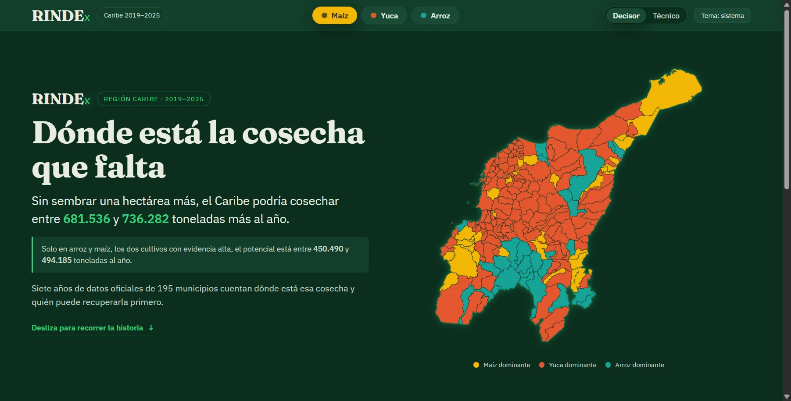
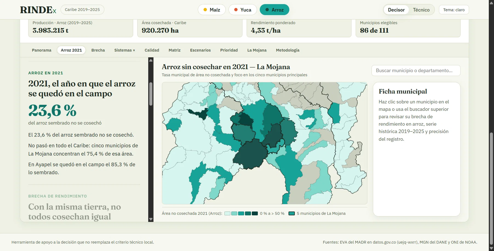
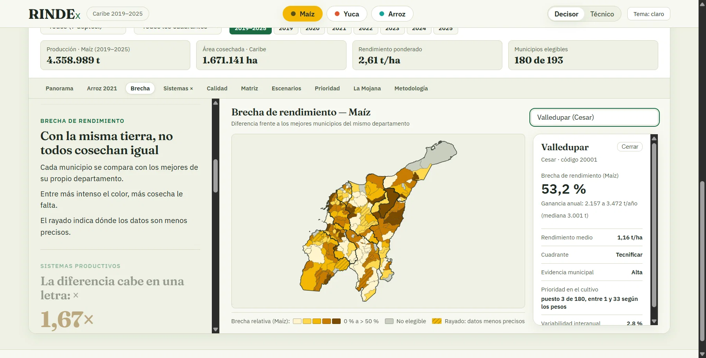
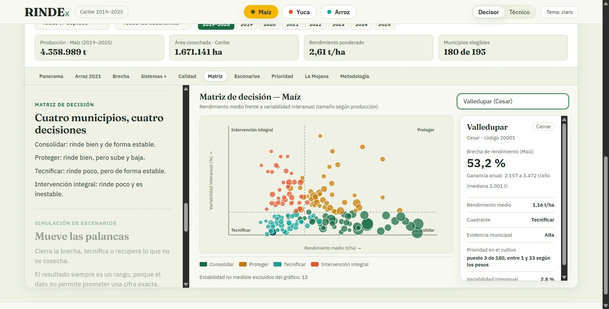
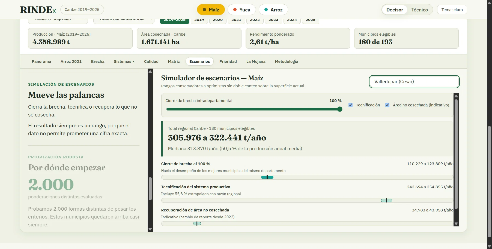
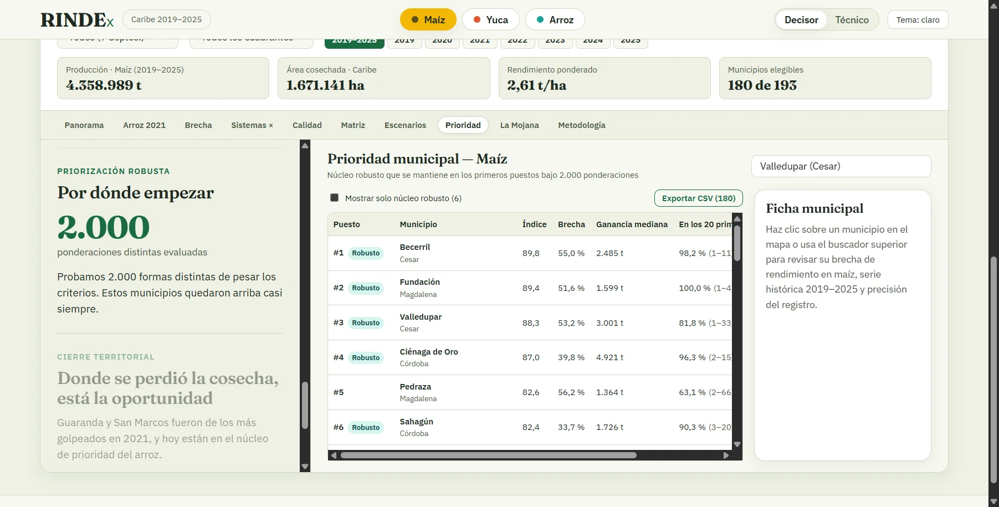

<h1 align="center">RINDEx</h1>

<p align="center">Inteligencia de brechas de rendimiento agrícola en la Región Caribe de Colombia.</p>

<p align="center"><a href="https://rindex.pages.dev">https://rindex.pages.dev</a></p>

<p align="center"></p>

## El problema

En el Caribe colombiano, dos municipios vecinos pueden sembrar el mismo cultivo y cosechar cantidades muy distintas por hectárea. Esa diferencia es cosecha que falta, y se puede recuperar sin ampliar la frontera agrícola. Las secretarías de agricultura y las entidades de desarrollo rural necesitan saber dónde está esa cosecha, cuánta es y qué la explica, para decidir por dónde empezar. RINDEx busca responder en qué municipios y cultivos se gana más producción cerrando la brecha de rendimiento, y qué factor observable la explica mejor: la tecnificación, el riego o el área que se siembra y no se cosecha.

## Los datos

| Fuente | Uso |
| :--- | :--- |
| Evaluaciones Agropecuarias Municipales EVA 2019 a 2025, del Ministerio de Agricultura en datos.gov.co | Producción, área sembrada, área cosechada y sistema productivo por municipio |
| Marco Geoestadístico Nacional 2025 del DANE | Límites municipales del Caribe |
| Índice Oceánico El Niño, ONI, de la NOAA | Clasificación climática de cada año en Niño, Niña o neutro |

Se analizan maíz, yuca y arroz en 195 municipios de los 7 departamentos continentales del Caribe: Atlántico, Bolívar, Cesar, Córdoba, La Guajira, Magdalena y Sucre. San Andrés queda fuera por sus volúmenes marginales y porque no es comparable con el continente. El año 2025 todavía puede estar incompleto en la fuente.

## El enfoque

- **El rendimiento se recalcula, no se promedia.** El rendimiento de cualquier agregado es producción total sobre área cosechada total. La columna de rendimiento que trae la fuente nunca se promedia.
- **Cada municipio se compara con su propio departamento.** La brecha mide cuánto le falta a un municipio para llegar al percentil 75 de los municipios de su departamento, así que nadie se compara con condiciones que no tiene.
- **Pruebas no paramétricas con tamaño del efecto.** Wilcoxon pareado por municipio para comparar sistemas productivos, Kruskal-Wallis entre departamentos y Wilcoxon sobre las pendientes de Theil-Sen de cada municipio para las tendencias. Cada resultado reporta el efecto con un intervalo bootstrap de 5.000 réplicas y la corrección de Holm o Benjamini-Hochberg según la familia de hipótesis.
- **Escenarios como rangos.** Tres palancas, cerrar la brecha, tecnificar y recuperar el área no cosechada, se combinan sin doble conteo y se publican como rangos p10, p50 y p90, nunca como una cifra única.
- **Prioridad que resiste cambios de criterio.** El índice de prioridad pesa ganancia, brecha, estabilidad y confiabilidad del dato. Se recalcula con 2.000 juegos de pesos aleatorios de Dirichlet, y solo forman el núcleo robusto los municipios que quedan en el Top 20 en al menos el 80 % de los casos.
- **Calidad del registro a la vista.** Cada cultivo y cada municipio recibe un nivel de evidencia según la repetición de valores entre años y la proporción de números redondos. Donde el dato es menos preciso, el mapa lo marca con rayado.

## Lo que se encontró

1. **Hay cosecha por recuperar sin sembrar más.** Sumando los tres cultivos, el Caribe podría cosechar entre 681.536 y 736.282 toneladas más al año. Solo en arroz y maíz, los cultivos con evidencia alta, el rango es de 450.490 a 494.185 toneladas.
2. **La tecnificación explica buena parte de la brecha.** En los mismos municipios y años, el maíz tecnificado rinde 1,67 veces lo que rinde el tradicional, con un intervalo del 95 % entre 1,55 y 1,80, en 60 municipios. Aun así, el 73,5 % del área cosechada de maíz sigue en el sistema tradicional.
3. **En arroz pesa el sistema de cultivo.** El arroz con riego rinde 2,02 veces el de secano manual, con un intervalo entre 1,63 y 2,73. El secano mecanizado rinde 1,62 veces el manual, con un intervalo entre 1,48 y 1,82. La comparación directa entre riego y mecanizado solo tiene 5 municipios y no se publica como hallazgo.
4. **2021 fue el año en que el arroz se quedó en el campo.** El 23,6 % del arroz sembrado no se cosechó, y cinco municipios de La Mojana y la depresión momposina concentraron el 75,4 % de esa área. En Ayapel no se cosechó el 85,3 % de lo sembrado.
5. **En siete años ningún cultivo mejoró su rendimiento de forma medible.** En arroz no hay tendencia, con equivalencia práctica dentro de más o menos 1 % anual. En maíz solo aparece una caída de 0,17 % anual al excluir series poco informativas. En yuca la tendencia no se puede medir por la repetición de valores.
6. **El dato de yuca orienta, pero no alcanza para firmar.** El 45,7 % de sus pares de años consecutivos repiten exactamente el mismo rendimiento, y 9 de cada 10 rendimientos son números redondos. Por eso la yuca se clasifica con evidencia baja.
7. **Hay un núcleo de municipios por donde empezar.** En maíz: Becerril, Fundación, Valledupar, Ciénaga de Oro, Sahagún y Cerro de San Antonio. En arroz: Guaranda, Montería, Tierralta, San Marcos, El Roble, Sahagún y San Bernardo del Viento. En yuca: Morroa, Ciénaga de Oro, Aracataca, Los Palmitos y Río de Oro.

## Recorrido por el sitio

**Portada.** El potencial de cosecha de la región y el mapa del cultivo dominante en cada municipio.

**Tablero.** Filtros por cultivo, departamento, cuadrante de decisión y año, con la producción, el área, el rendimiento ponderado y los municipios elegibles. Dos modos de lectura: decisor y técnico.

<p align="center"></p>

**Arroz 2021.** El área no cosechada por municipio en el año del golpe, con foco en La Mojana.

<p align="center"></p>

**Brecha y ficha municipal.** El mapa de brecha relativa de cada cultivo y, al elegir un municipio, su ganancia anual, rendimiento, cuadrante, nivel de evidencia y puesto en la prioridad.

<p align="center"></p>

**Matriz de decisión.** Rendimiento medio frente a variabilidad interanual, en cuatro cuadrantes: consolidar, proteger, tecnificar e intervención integral.

<p align="center"></p>

**Simulador de escenarios.** Las tres palancas se activan por separado y el resultado siempre se muestra como rango.

<p align="center"></p>

**Prioridad.** La tabla de municipios con su índice, brecha, ganancia mediana y frecuencia en el Top 20, exportable a CSV.

**Sistemas, calidad, La Mojana y metodología.** Las razones de rendimiento entre sistemas productivos, la calidad del registro por cultivo, el cierre territorial y la forma en que se calculan y auditan las cifras.

## Alcance y limitaciones

Las EVA son estimaciones administrativas de las secretarías municipales, no mediciones de campo: en yuca, sobre todo, muchos valores son redondos o se repiten de un año a otro. Desde 2022 la siembra del semestre A se cosecha en el B, así que el área no cosechada se calcula solo por año y se reporta como área no cosechada, no como pérdida. La recuperación de esa área es un escenario indicativo. La brecha toma como referencia el percentil 75 de cada departamento, no un rendimiento potencial agronómico, y no considera suelos, precios ni crédito. El clima entra solo como clasificación anual del ONI, y con siete años no se encontró asociación con el rendimiento. RINDEx es una herramienta de apoyo a la decisión y no reemplaza el criterio técnico local.

## Validación

Cada cifra publicada se puede rastrear hasta la función del pipeline que la calcula y una prueba que la verifica. Una auditoría independiente recalcula los indicadores desde el archivo original de la fuente, sin importar ningún módulo del pipeline, y aprobó 96 de 96 verificaciones. Los contratos de datos de la web están en [contratos/web/](contratos/web/) y los reportes de análisis en [docs/](docs/):

| Documento | Contenido |
| :--- | :--- |
| [plan_analisis.md](docs/plan_analisis.md) | Hipótesis preespecificadas y reglas de decisión |
| [perfil_datos.md](docs/perfil_datos.md) | Perfil de la fuente y conteos de registros |
| [validacion_limpieza.md](docs/validacion_limpieza.md) | Validaciones cruzadas de cada etapa de limpieza |
| [calidad_series.md](docs/calidad_series.md) | Diagnóstico de calidad del registro por cultivo y municipio |
| [resultados_estadisticos.md](docs/resultados_estadisticos.md) | Pruebas, tamaños del efecto, intervalos y robustez |
| [priorizacion.md](docs/priorizacion.md) | Índice de prioridad y núcleo robusto |
| [auditoria_independiente.md](docs/auditoria_independiente.md) | Recálculo independiente de las cifras publicadas |
| [desviaciones_plan.md](docs/desviaciones_plan.md) | Cambios frente al plan original y su justificación |

## Créditos

**Autor**

- Daniel Andrés Jiménez Povea

**Fuentes de datos**

| Conjunto de datos | Responsable | Licencia |
| :--- | :--- | :--- |
| [Evaluaciones Agropecuarias Municipales EVA 2019 a 2025](https://www.datos.gov.co/Agricultura-y-Desarrollo-Rural/Evaluaciones-Agropecuarias-Municipales-EVA-2019-20/uejq-wxrr/about_data) | Ministerio de Agricultura y Desarrollo Rural, publicado en datos.gov.co | Datos Abiertos Colombia |
| [Marco Geoestadístico Nacional 2025](https://geoportal.dane.gov.co/) | DANE | [CC BY 4.0](https://creativecommons.org/licenses/by/4.0/) |
| [Oceanic Niño Index, ERSST.v5](https://www.cpc.ncep.noaa.gov/data/indices/oni.ascii.txt) | NOAA Climate Prediction Center | Dominio público, obra del gobierno de Estados Unidos |

Los datos se usaron depurados, agregados por municipio, cultivo y año, y transformados en brechas, escenarios e índices.

**Software y servicios**

| Nombre | Licencia | Enlace |
| :--- | :--- | :--- |
| React | MIT | [github.com/facebook/react](https://github.com/facebook/react) |
| Vite | MIT | [github.com/vitejs/vite](https://github.com/vitejs/vite) |
| TypeScript | Apache-2.0 | [github.com/microsoft/TypeScript](https://github.com/microsoft/TypeScript) |
| D3 | ISC | [github.com/d3/d3](https://github.com/d3/d3) |
| topojson-client | ISC | [github.com/topojson/topojson-client](https://github.com/topojson/topojson-client) |
| Scrollama | MIT | [github.com/russellsamora/scrollama](https://github.com/russellsamora/scrollama) |
| Zustand | MIT | [github.com/pmndrs/zustand](https://github.com/pmndrs/zustand) |
| Fontsource, con Fraunces e IBM Plex Sans | MIT, fuentes bajo SIL OFL 1.1 | [github.com/fontsource/fontsource](https://github.com/fontsource/fontsource) |
| pandas | BSD-3-Clause | [github.com/pandas-dev/pandas](https://github.com/pandas-dev/pandas) |
| PyArrow, de Apache Arrow | Apache-2.0 | [github.com/apache/arrow](https://github.com/apache/arrow) |
| SciPy | BSD-3-Clause | [github.com/scipy/scipy](https://github.com/scipy/scipy) |
| pandera | MIT | [github.com/unionai-oss/pandera](https://github.com/unionai-oss/pandera) |
| Shapely | BSD-3-Clause | [github.com/shapely/shapely](https://github.com/shapely/shapely) |
| topojson para Python | BSD-3-Clause | [github.com/mattijn/topojson](https://github.com/mattijn/topojson) |
| uv | MIT o Apache-2.0 | [github.com/astral-sh/uv](https://github.com/astral-sh/uv) |
| Cloudflare Pages, alojamiento del sitio | Servicio con términos de uso | [cloudflare.com/website-terms](https://www.cloudflare.com/website-terms/) |

## Derechos

© 2026 Daniel Andrés Jiménez Povea. Todos los derechos reservados.

Los datos pertenecen a sus fuentes y se usan según sus términos.

## Correr en local

Requiere Python 3.12 con [uv](https://github.com/astral-sh/uv) y Node.js 20 o superior.

### Sitio

El sitio solo necesita los datos versionados de `web/public/data/`.

```bash
cd web
npm ci
npm run dev
```

### Pipeline

Los datos crudos no se versionan. La EVA se descarga del [recurso uejq-wxrr](https://www.datos.gov.co/Agricultura-y-Desarrollo-Rural/Evaluaciones-Agropecuarias-Municipales-EVA-2019-20/uejq-wxrr/about_data) y se guarda en `data/raw/eva_2019_2025.xlsx`. Las rutas, la región, los cultivos, los años, la semilla y los umbrales de cada edición están en [config/caribe_2019_2025.yaml](config/caribe_2019_2025.yaml). El pipeline regenera los reportes de `docs/` y los JSON de la web, y termina con la auditoría independiente.

```bash
uv sync
uv run python -m rindex --config config/caribe_2019_2025.yaml
```

### Pruebas

```bash
uv run ruff check
uv run ruff format --check
uv run pytest
cd web
npm run lint
npm run typecheck
npm run test
npm run build
```
